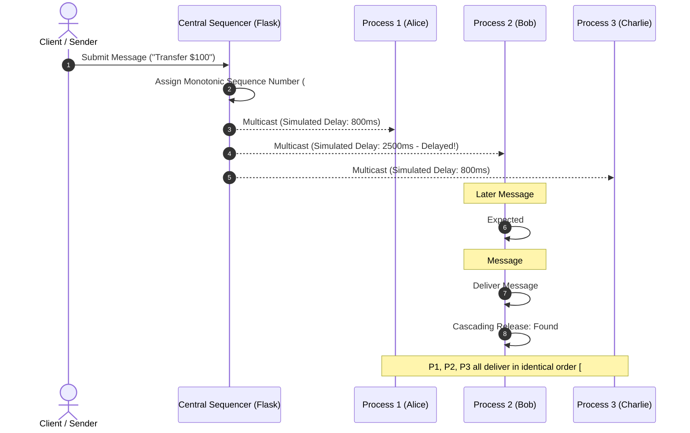

# Group Message Order Tester
**Total Order Multicast Simulation using a Centralized Sequencer**

A complete, beginner-friendly, and interactive academic web simulation for Distributed Systems coursework. This project visually and logically demonstrates how distributed nodes deliver multicast messages in the **exact same global sequence**, despite random network latency and out-of-order physical packet arrivals.

---

## 1. Project Introduction

In distributed systems, communication across independent nodes is prone to network jitter, varying transit delays, and out-of-order packet arrivals. Without total ordering, nodes would process updates in whatever order packets reach them, causing replicas to diverge and corrupt state consistency.

**Group Message Order Tester** models a 3-process group ($P_1$ Alice, $P_2$ Bob, and $P_3$ Charlie) coordinated by a **Centralized Sequencer**. Every message submitted to the group is first stamped by the Sequencer with a monotonically increasing sequence number ($1, 2, 3, \dots$). Even if network jitter causes Message #2 to arrive at a process before Message #1, the node holds Message #2 in its **Pending Buffer** and only delivers it once Message #1 has arrived and been delivered.

---

## 2. Aim and Objectives

- **Aim:** To build and demonstrate a centralized Total Order Multicast protocol simulator with real queue buffering and automated consistency verification.
- **Objectives:**
  1. Implement a thread-safe Centralized Sequencer backend in Python Flask.
  2. Simulate network transit latency with configurable manual delays ($0-5000\text{ ms}$) and random jitter mode.
  3. Model independent process buffers for each node: Physical Received Buffer, Pending Hold Buffer, and Delivered Order List.
  4. Implement cascading release logic: when a missing sequence number arrives, consecutively queued messages are automatically released and delivered in sequence.
  5. Provide automated mathematical verification comparing the delivery histories of $P_1$, $P_2$, and $P_3$.
  6. Present a clean, responsive academic dashboard with beginner-friendly Hinglish explanations.

---

## 3. Technologies Used (With What / Why / How Explanations)

### Python Flask
- **What:** Python ka lightweight, clean web framework.
- **Why:** Backend API endpoints provide karne ke liye aur Sequencer state ko server-side maintain karne ke liye.
- **How:** Browser se incoming HTTP requests (`/api/send`, `/api/process/arrive`, `/api/verify`) aati hain, Flask unhe thread-safe tareeqe se process karta hai aur JSON return karta hai.

### Vanilla JavaScript (ES6)
- **What:** Pure client-side JavaScript bina kisi external heavy library (React/Node) ke.
- **Why:** Simple timers (`setTimeout`) ke through transit delays simulate karne aur UI ko dynamically render karne ke liye.
- **How:** Network delay timers expire hone par `/api/process/arrive` ko call karta hai aur buffer states ko live update karta hai.

### HTML5 & CSS3
- **What:** Standard responsive semantic markup aur styling.
- **Why:** Desktop, tablet aur mobile par ek clean, modern academic dashboard provide karne ke liye.
- **How:** CSS Grid aur Flexbox use karke responsive cards aur distinct badges render karta hai.

### Python `threading.Lock`
- **What:** Server-side synchronization lock.
- **Why:** Flask multi-threaded environment mein shared in-memory dictionaries ko race conditions se protect karne ke liye.
- **How:** Request process karte waqt `with state_lock:` block ke andar state update hota hai taaki do concurrent requests ek saath data corrupt na karein.

---

## 4. Folder Structure

```text
group-message-order-tester/
├── app.py                  # Core Flask backend, Sequencer logic, API routes
├── requirements.txt        # Production & local dependencies (Flask, Gunicorn)
├── README.md               # Comprehensive documentation & guide
├── .gitignore              # Git ignore rules for Python & environments
├── test_simulation.py      # Automated test suite (8 test scenarios)
├── templates/
│   └── index.html          # Semantic HTML5 academic dashboard
└── static/
    ├── css/
    │   └── style.css       # Responsive light-theme CSS styles
    └── js/
        └── script.js       # Transit simulation, timer queues, UI updates
```

---

## 5. Setup and Run Instructions (Local)

### Prerequisites
- Python 3.9 or newer installed on your computer.

### Step-by-Step Execution:

1. **Clone or navigate to the project directory:**
   ```bash
   cd group-message-order-tester
   ```

2. **(Optional but recommended) Create and activate a virtual environment:**
   - **Windows (PowerShell):**
     ```powershell
     python -m venv venv
     .\venv\Scripts\Activate.ps1
     ```
   - **Linux / macOS:**
     ```bash
     python3 -m venv venv
     source venv/bin/activate
     ```

3. **Install dependencies:**
   ```bash
   pip install -r requirements.txt
   ```

4. **Start the Flask server:**
   ```bash
   python app.py
   ```

5. **Open the application in your browser:**
   Open: [http://127.0.0.1:5000](http://127.0.0.1:5000)

---

## 6. How the Simulation Works (Core Algorithm)



### Algorithm Steps:
1. **Message Submission:** User selects a sender (Alice, Bob, Charlie) and enters text.
2. **Central Sequencing:** Backend receives request, assigns increasing sequence number $S = 1, 2, 3...$ and ID `MSG-xxx`.
3. **Multicast Transit:** The sequenced packet is multicast to $P_1$, $P_2$, $P_3$ with simulated delays.
4. **Buffer Evaluation:**
   - When a packet with sequence number $S$ arrives at process $P_i$:
   - If $S == P_i.\text{expected\_seq}$:
     - Deliver $S$ immediately.
     - Increment $P_i.\text{expected\_seq} \leftarrow P_i.\text{expected\_seq} + 1$.
     - **Cascading Check:** Loop through pending buffer; deliver any consecutive sequence numbers now unblocked.
   - If $S > P_i.\text{expected\_seq}$:
     - Message arrived out-of-order!
     - Hold packet in $P_i.\text{pending\_buffer}$.
5. **Verification:** Compare delivered message sequence across all 3 nodes.

---

## 7. Important Functions and API Endpoints

### API Endpoints

| Endpoint | Method | Description |
| :--- | :--- | :--- |
| `GET /` | `GET` | Serves the main responsive dashboard interface (`index.html`). |
| `POST /api/send` | `POST` | Validates message input and assigns global sequence number via Central Sequencer. |
| `POST /api/process/arrive` | `POST` | Records packet arrival at a specific process node ($P_1, P_2, P_3$), manages buffers, executes deliveries, and cascades pending packets. |
| `GET /api/state` | `GET` | Returns full current snapshot of sequencer messages, process buffers, and event logs. |
| `POST /api/reset` | `POST` | Atomically clears all buffers, logs, counters, and delivery histories. |
| `GET /api/verify` | `GET` | Performs formal mathematical consistency check across $P_1, P_2, P_3$ delivery histories. |

### Key Functions Explained (Hinglish What / Why / How)

#### `send_message()` in `app.py`
- **What:** Message validation aur sequencing endpoint.
- **Why:** Taaki client seedha fake sequence number na daal sake; backend hi single source of truth rahe.
- **How:** Input text validate karta hai, `sequencer.next_seq` padhta hai, message object banata hai, aur counter increment karta hai.

#### `process_arrival()` in `app.py`
- **What:** Core distributed delivery aur queue buffering function.
- **Why:** Out-of-order arrival ko handle karne aur total order preserve karne ke liye.
- **How:** Check karta hai `seq == expected_seq`. Agar match kare toh deliver karke cascading pending loop chalata hai; warna pending list mein hold karta hai.

#### `verify_total_order()` in `app.py`
- **What:** Automated consistency checker.
- **Why:** Prove karne ke liye ki teeno nodes ne exactly identical delivery history maintain ki.
- **How:** $P_1, P_2, P_3$ ke delivered IDs ko compare karta hai aur prefix consistency check karta hai.

---

## 8. Testing Instructions & Results

An automated test suite with **8 comprehensive test scenarios** is included in `test_simulation.py`.

### Run Automated Tests:
```bash
python test_simulation.py
```

### Verified Test Matrix:
| Test ID | Scenario | Expected Outcome | Actual Result |
| :--- | :--- | :--- | :--- |
| **Test 1** | Basic in-order delivery | 3 messages delivered in identical order across $P_1, P_2, P_3$ | **PASSED** (0.058s) |
| **Test 2** | Out-of-order arrival & buffer hold | Message #2 held pending when arriving before Message #1; cascades upon Message #1 arrival | **PASSED** |
| **Test 3** | Asymmetric process delays | Physical arrival orders differ ($P_1: 1\to 2\to 3$, $P_2: 2\to 3\to 1$, $P_3: 3\to 1\to 2$), delivery orders match | **PASSED** |
| **Test 4** | Input validation | Empty messages, spaces, and invalid senders rejected with HTTP 400 | **PASSED** |
| **Test 5** | Simulation Reset | All sequence counters, process buffers, logs, and delivery histories restored to 0/1 | **PASSED** |
| **Test 6** | Verification failure detector | Checker detects contradictory delivery histories and returns `FAIL` | **PASSED** |
| **Test 7** | Responsiveness & Route | Server returns 200 OK with responsive viewport tags and complete DOM elements | **PASSED** |
| **Test 8** | Backend error handling | 404 on missing message, 400 on invalid node ID, 409 on duplicate arrival | **PASSED** |

---

## 9. Academic Demonstration Script (Viva / Presentation Guide)

When presenting this project to an evaluator, follow this 3-minute demonstration script:

1. **Step 1: Introduction (30 seconds)**
   - *"Respected Professor, this project demonstrates Total Order Multicast using a Centralized Sequencer in Distributed Systems."*
   - Point out the 3 distributed processes: Alice ($P_1$), Bob ($P_2$), and Charlie ($P_3$).

2. **Step 2: Demonstrate Normal Delivery (45 seconds)**
   - Click **"Scenario 1: Synchronous In-Order Delivery"**.
   - Show how the Central Sequencer assigns Seq #1, #2, #3 and each process delivers them in order. Verification badge turns **PASS**.

3. **Step 3: Demonstrate Out-of-Order Packet Arrival & Pending Buffer (60 seconds) - *Key Highlight***
   - Click **"Scenario 2: Out-of-Order Arrival (Buffer Demo)"**.
   - Highlight **Bob ($P_2$)**: Message #2 arrives at Bob at $t=800\text{ ms}$, but Bob's expected sequence number is 1!
   - Show how Bob holds Message #2 in the **Pending Buffer** (status: *Holding Pending*). Message #2 is NOT delivered yet.
   - At $t=2800\text{ ms}$, Message #1 finally arrives at Bob. Bob delivers Message #1, and instantly performs a **Cascading Delivery** to release Message #2 from the pending queue!
   - Highlight: Despite physical arrival order being $[M_2, M_1]$, delivery order is $[M_1, M_2]$.

4. **Step 4: Verify Total Order Consistency (45 seconds)**
   - Scroll to Section 5: **Total Order Multicast Verification**.
   - Show that all three processes have identical delivery sequence tracks.
   - The checklist shows: Matching Sequences ✓, Monotonic Sequencing ✓, Buffer Resolution ✓.

---

## 10. Free Deployment Instructions

This repository is ready to deploy for free on cloud platforms that support Python WSGI applications:

### Option A: Render.com (Recommended Free Hosting)
1. Push your repository to **GitHub**:
   ```bash
   git init
   git add .
   git commit -m "Initial commit of Group Message Order Tester"
   git branch -M main
   git remote add origin https://github.com/YOUR_USERNAME/group-message-order-tester.git
   git push -u origin main
   ```
2. Log in to [Render.com](https://render.com) and click **New + > Web Service**.
3. Select your GitHub repository.
4. Configure service settings:
   - **Environment:** `Python 3`
   - **Build Command:** `pip install -r requirements.txt`
   - **Start Command:** `gunicorn app:app`
   - **Instance Type:** `Free`
5. Click **Create Web Service**. Render will build and deploy your live public URL!

### Option B: PythonAnywhere (Free Tier)
1. Create a free account at [PythonAnywhere.com](https://www.pythonanywhere.com).
2. Go to the **Web** tab, click **Add a new web app**, choose **Flask** and **Python 3.10+**.
3. In the Files tab, upload the project files or clone using git bash.
4. Set the WSGI configuration file to point to `app.py`.
5. Reload the web app to access your live site at `yourusername.pythonanywhere.com`.

---

## 11. Known Limitations

- **Centralized Bottleneck & Single Point of Failure (SPOF):** In real-world large-scale distributed systems, a single centralized sequencer can become a throughput bottleneck and a single point of failure (if the sequencer crashes, sequencing halts). Distributed sequencer schemes (like Paxos or Raft consensus) are used for fault tolerance.
- **In-Memory Volatility:** To remain strictly database-free and beginner-friendly, all buffers and sequences are stored in server memory. Restarting the server resets the simulation.
- **Software Simulation:** Transit delays are simulated via software timers; physical hardware packet loss or UDP socket retransmission is not modeled.

---

## 12. License & Academic Integrity

Developed for academic coursework in **Distributed Computing / Distributed Systems**. Open for study, educational demonstrations, and viva examinations.
