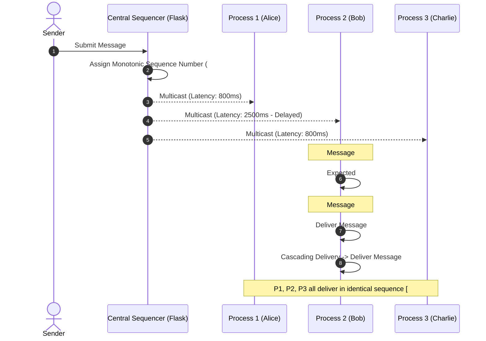

# Group Message Order Tester
**Total Order Multicast Simulation using a Centralized Sequencer**

A web-based distributed systems simulator demonstrating how independent process nodes achieve Total Order Multicast consistency using a Centralized Sequencer. The application models network latency, out-of-order packet arrivals, queue buffering, and cascading deliveries.

---

## Features

- **Centralized Sequencer**: Monotonically increasing global sequence numbers assigned to incoming multicast messages.
- **Process Buffers**: Independent tracking of Physical Received Buffer, Pending Hold Buffer, and Delivered Order for each process (Alice, Bob, Charlie).
- **Out-of-Order Handling & Cascading Delivery**: Holds messages with sequence numbers greater than expected in a pending buffer, triggering sequential release once missing preceding packets arrive.
- **Network Latency Simulation**: Per-process manual delay sliders (0–5000 ms) and random jitter simulation.
- **Automated Consistency Verification**: Formal consistency checker that verifies prefix and global sequence matching across all node delivery histories.
- **Audit Timeline Log**: Filterable event log detailing message submission, sequencing, arrival, buffering, and delivery.

---

## Technologies Used

- **Backend**: Python 3, Flask
- **Concurrency**: Python `threading.Lock` for thread-safe in-memory state manipulation
- **Frontend**: Vanilla JavaScript (ES6+), HTML5, CSS3

---

## Project Structure

```text
group-message-order-tester/
├── app.py                  # Flask backend, Sequencer logic, API endpoints
├── requirements.txt        # Python dependencies
├── README.md               # Documentation
├── .gitignore              # Git ignore rules
├── test_simulation.py      # Automated test suite (8 test scenarios)
├── templates/
│   └── index.html          # Dashboard interface
└── static/
    ├── css/
    │   └── style.css       # Application styling
    └── js/
        └── script.js       # Simulation controls, transit timers, UI rendering
```

---

## Prerequisites

- Python 3.9 or higher
- pip (Python package manager)

---

## Installation & Setup

1. **Create and activate a virtual environment (recommended):**
   - **Windows (PowerShell):**
     ```powershell
     python -m venv venv
     .\venv\Scripts\Activate.ps1
     ```
   - **Linux / macOS:**
     ```bash
     python3 -m venv venv
     source venv/bin/activate
     ```

2. **Install dependencies:**
   ```bash
   pip install -r requirements.txt
   ```

3. **Start the application:**
   ```bash
   python app.py
   ```

4. **Access the dashboard:**
   Open [http://127.0.0.1:5000](http://127.0.0.1:5000) in your web browser.

---

## How It Works



### Algorithm

1. **Submission**: A process submits a message with content and origin identifier.
2. **Sequencing**: The central sequencer assigns the next monotonic sequence number $S$ and unique message ID.
3. **Multicast Dispatch**: The packet is multicast to all group processes with simulated transit delays.
4. **Buffer Evaluation**:
   - When message $S$ reaches process $P_i$:
   - If $S == P_i.\text{expected\_seq}$:
     - Deliver $S$ to application history.
     - Increment $P_i.\text{expected\_seq}$.
     - Check pending buffer and cascade-deliver any consecutive buffered messages.
   - If $S > P_i.\text{expected\_seq}$:
     - Hold message in $P_i.\text{pending\_buffer}$ sorted by sequence number.
5. **Verification**: Compare delivery sequences across all processes to confirm identical delivery order.

---

## API Endpoints

| Endpoint | Method | Description |
| :--- | :--- | :--- |
| `GET /` | `GET` | Serves the main simulation dashboard (`index.html`). |
| `POST /api/send` | `POST` | Validates message input and assigns global sequence number via Central Sequencer. |
| `POST /api/process/arrive` | `POST` | Records packet arrival at a process node, manages buffers, and executes deliveries. |
| `GET /api/state` | `GET` | Returns full current snapshot of sequencer messages, process buffers, and logs. |
| `POST /api/reset` | `POST` | Clears all buffers, event logs, counters, and delivery histories. |
| `GET /api/verify` | `GET` | Performs consistency check across process delivery histories. |

---

## Automated Testing

Run the test suite covering 8 scenarios:

```bash
python test_simulation.py
```

### Test Coverage

- **Scenario 1**: Basic in-order delivery across all processes.
- **Scenario 2**: Out-of-order arrival, pending queue hold, and cascading release.
- **Scenario 3**: Asymmetric network delays and physical arrival divergence vs. delivery convergence.
- **Scenario 4**: Input validation (empty content, whitespace, invalid senders, length limits).
- **Scenario 5**: Simulation reset functionality.
- **Scenario 6**: Total order verification failure detection on conflicting histories.
- **Scenario 7**: Route serving and responsive HTML dashboard rendering.
- **Scenario 8**: Backend error handling (invalid node ID, unknown message ID, duplicate arrivals).

---

## Technical Considerations

- **In-Memory Storage**: Simulation state is stored in memory; restarting the server resets state.
- **Simulated Delays**: Latencies are modeled using timers; no physical network sockets are required.
